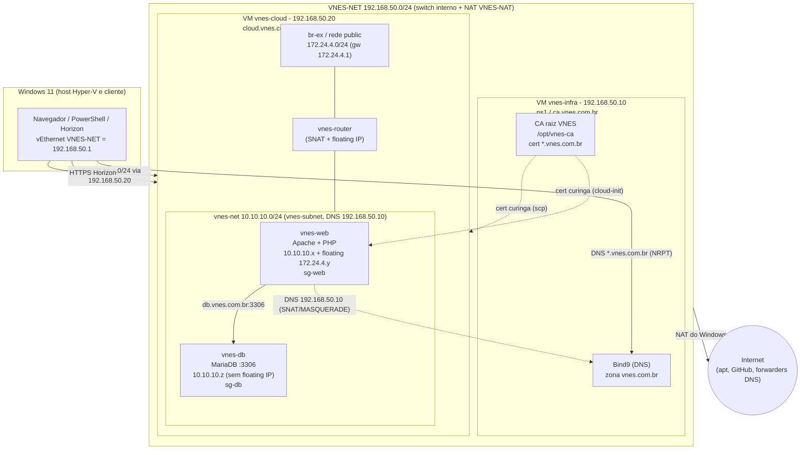

# Passo II - Topologia (REQ09)

Topologia escolhida: **Ideal** - Windows (cliente) + VM `vnes-infra` (DNS + CA) + VM `vnes-cloud` (DevStack) com as instâncias `vnes-web` e `vnes-db` dentro da nuvem.

## Diagrama

## Endereços e nomes

| Elemento | IP | Nome DNS | Observação |
|---|---|---|---|
| Windows (cliente) | 192.168.50.1 | - | gateway/NAT das VMs; rota `172.24.4.0/24` via `192.168.50.20` |
| `vnes-infra` | 192.168.50.10 | `ns1.vnes.com.br`, `ca.vnes.com.br` | Bind9 + CA (2 vCPU, 1 GB) |
| `vnes-cloud` | 192.168.50.20 | `cloud.vnes.com.br` | DevStack, Horizon HTTPS (4 vCPU, 11 GB, nested virt) |
| `public` (br-ex) | 172.24.4.0/24, gw 172.24.4.1 | - | floating IPs |
| `vnes-net` | 10.10.10.0/24 | - | rede privada do projeto `vnes`, DNS `192.168.50.10` |
| `vnes-web` | 10.10.10.x + floating 172.24.4.y | `www.vnes.com.br`, `vnes.com.br` | `sg-web` (22, 80, 443, ICMP) |
| `vnes-db` | 10.10.10.z (só privado) | `db.vnes.com.br` | `sg-db` (3306 e 22 só de `sg-web`) |

Os IPs `10.10.10.x/z` e `172.24.4.y` só são conhecidos depois de criar as instâncias; os registros `db`, `www` e `@` do DNS são atualizados com `infra/dns/atualizar-registro.sh`.

## Fluxos de tráfego

**Cliente acessa a aplicação** (`https://www.vnes.com.br`):

1. O Windows consulta `www.vnes.com.br`. A regra NRPT `.vnes.com.br` envia a consulta ao Bind em `192.168.50.10`, que responde com a floating IP (`172.24.4.y`).
2. O Windows não conhece `172.24.4.0/24`, mas tem a rota persistente via `192.168.50.20` (`vnes-cloud`).
3. A `vnes-cloud` encaminha o pacote por `br-ex` ao `vnes-router`, que faz o DNAT da floating IP para o IP privado `10.10.10.x` da `vnes-web`.
4. A `vnes-web` (Apache) redireciona HTTP para HTTPS e apresenta o certificado `*.vnes.com.br`, assinado pela CA importada no Windows.

**Aplicação acessa o banco:** o PHP resolve `db.vnes.com.br` (DNS configurado na subnet: `192.168.50.10`) e conecta em `10.10.10.z:3306`. O tráfego fica **inteiro na rede privada**; o `sg-db` só aceita origem do grupo `sg-web`.

**Instância consulta DNS ou sai para a internet** (`apt`, `git clone`): o pacote sai pelo `vnes-router` (SNAT para o IP do gateway em `172.24.4.0/24`) e a `vnes-cloud` aplica `MASQUERADE` (`172.24.4.0/24 -> eth0`) em direção à `192.168.50.0/24`. O Bind enxerga a origem como `192.168.50.20` (permitida pela ACL `vnes-clients`). A internet sai pelo NAT do Windows (`VNES-NAT`).

**Distribuição do certificado:** a `vnes-infra` envia o curinga à `vnes-cloud` com `03-distribuir.sh` (Horizon) e o embute no cloud-init da `vnes-web` (`render.sh`).

## Por que a topologia Ideal

| Opção | Resumo | Limite |
|---|---|---|
| Mínima | Tudo em uma VM (ou só o DevStack), DNS/CA improvisados no mesmo lugar | Não separa papéis; DNS e CA caem junto com a nuvem; menos convincente para REQ10 e REQ11 |
| Completa | Várias VMs (controller, compute, DNS, CA, banco) | Não cabe nos 15 GB do host; instalação longa e frágil |
| **Ideal (escolhida)** | `vnes-infra` leve (1 GB) para DNS+CA e uma `vnes-cloud` com o DevStack all-in-one; web e banco como instâncias OpenStack | Cabe no hardware (11 + 1 GB) e demonstra papéis separados: serviços de infraestrutura fora da nuvem, aplicação dentro dela |

Motivos principais: (1) DNS e CA independentes da nuvem, como em uma empresa; (2) web e banco em instâncias distintas, com banco sem IP público; (3) o consumo de RAM fecha com folga para duas instâncias `vnes.small`.

## Checkpoint do Passo II

- [ ] Consigo explicar, olhando o diagrama, os 3 fluxos acima.
- [ ] Tenho a tabela de IPs/nomes à mão para o vídeo.
